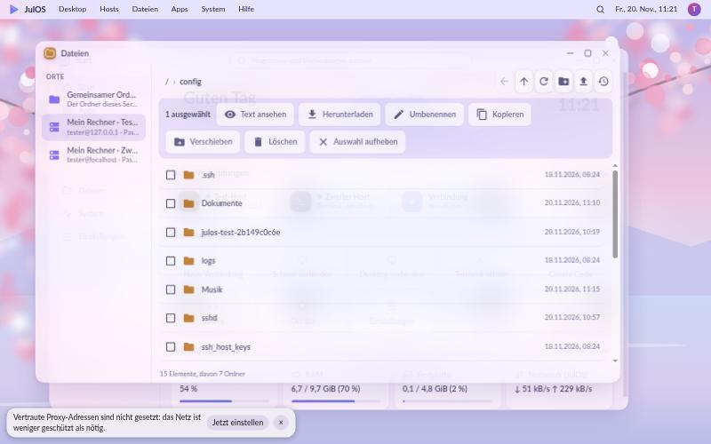
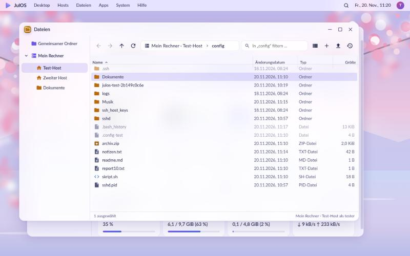
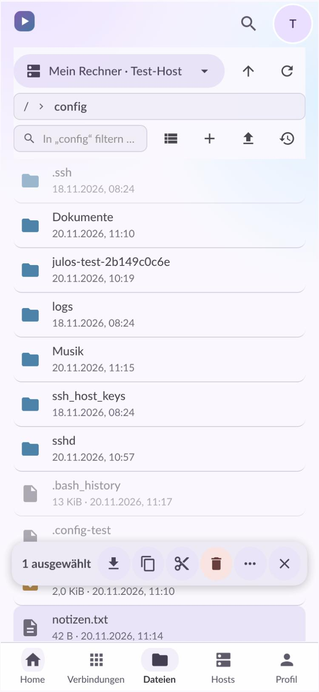

# Files app as a real explorer

Status: **built** (branch `claude/explorer-30d19a`, not released yet), requested by the owner on 2026-11-20. It follows the root-file work (`files-root`, see [FILES.md](FILES.md)) and the host login ([HOSTS.md](HOSTS.md#login-one-user-and-password-per-host)) because it changes the same screens.
The goal: the Files app feels like the Windows Explorer the owner knows, on the desktop with a mouse and keyboard, and stays usable on the phone. No server endpoint was added; the confirmation flow, the limits and the security model of [FILES.md](FILES.md) are unchanged.

| Before | After (desktop, light) | After (desktop, dark) | After (phone) |
|---|---|---|---|
|  |  |  |  |

## What was asked for, and what is built

### 1. Behaviour (mouse and keyboard)

- **One click selects, double click opens**: a folder is entered, a text file opens in the editor (below), anything else is downloaded. Link to a folder: entered. On the shared folder (read only) a file is downloaded.
- **Selection like the Explorer:** `Shift` selects a range from the anchor, `Ctrl` adds or removes single items (`Ctrl+Shift` adds a range), `Ctrl+A` all, a **rubber band** dragged on empty space (with `Ctrl` it adds), `Esc` clears. A right click on an item outside the selection selects only that item, inside it keeps the selection.
- **Keys:** `Up`/`Down` (in tiles also `Left`/`Right`), `Home`, `End`, `PageUp`/`PageDown`, with `Shift` they extend the range, with `Ctrl` they only move the focus (`Ctrl+Space` toggles). `Enter` or `Ctrl+Down` opens, `Backspace` or `Alt+Up` goes up, `Alt+Left` back, `Alt+Right` forward, `F2` rename (the name without the extension is preselected), `Del` delete, `F5` refresh, `Ctrl+C`, `Ctrl+X`, `Ctrl+V`, `Ctrl+Shift+N` new folder, `Ctrl+L` edit the path, `Ctrl+F` search, the menu key or `Shift+F10` opens the context menu at the focused item.
- **Type to jump:** typing letters jumps to the first item whose name starts with them; the buffer clears after one second, more letters narrow the match (`do` finds `Documents`), the same letter again and again cycles through all items with that letter. Case does not matter.
- **Context menu** (item, selection, folder, empty area): Open, Download, Cut, Copy, Paste (into the folder or the current folder), Rename, Delete, New folder, New text file, Upload, Refresh, Copy path, Pin to sidebar / Unpin, Properties. Entries that need writing are greyed out (with the reason as tooltip) when writing is off, on the shared folder and in a place without write access.
- **Cut, copy, paste** work within a place and **across places** (the existing server-side stream copy; the clipboard holds only paths and is shared by all windows of the page). **Drag and drop**: files from the list onto a folder row, a path segment of the address bar, a place or a pinned folder in the sidebar; within one place the default is *move* (`Ctrl` copies), between places *copy* (`Shift` moves), as in the Explorer. Files from the computer dropped on a folder row, a path segment or a sidebar entry are uploaded there. Pins can be dragged to reorder them.
- **Every write is one confirmation per action** through the server-issued two-step flow of [FILES.md](FILES.md): a selection of 40 files that is moved, copied or deleted opens one sheet and runs one job, never one per file.

### 2. Look

- One toolbar: back, forward, up, refresh, the **address bar** (path as clickable segments; a click on the empty part or `Ctrl+L` turns it into a text field, `Enter` goes, `Esc` cancels), the search field, the **View** menu (list or tiles, compact or comfortable, sort by name, date, type or size, ascending or descending, "Hidden files"), **New** (folder, text file) and **Upload**, and the history. Icons are SVG, never emoji. Below 900 px the buttons show only their icon.
- **Compact list is the default** with the columns *Name, Date modified, Type, Size*; a click on a header sorts (a second click reverses; folders always stay on top; numbers sort naturally, so `file2` comes before `file10`); the column widths can be dragged (or changed with the arrow keys on the focused grip) and are remembered.
- **File extensions are always shown**, there is no setting. The type column shows the extension (`PNG file`, `Folder`).
- **Hidden files** (names starting with a dot) **are shown by default but dimmed** (lighter text and icon); the View menu hides them; remembered per user.
- **Status bar:** number of items (and how many are folders), or the number and size of the selection, and on the right the place and the user it works as (`Host as tester`, root place: `as root`). The root place keeps its red banner and the red mark under the toolbar.
- Names are foreign data: they are always set as text, and control characters, bidi overrides (U+202A-202E, U+2066-2069) and zero-width marks are shown as `<U+202E>` and never take effect (`files-explorer.js`, `safeName`); a name like `.txt` stays text (tried in the browser).

### 3. Sidebar as a tree

- The shared folder stands on its own; **every host is a node** that expands to its places (*Home* of each SSH connection, *Root* when the agent allows it, with the red shield) and to **its pinned folders**. A host with several SSH connections lists each as its own place.
- **Pin to sidebar** from the context menu of a folder (or the empty area of the current folder), **unpin**, **move up/down** in the pin's menu or by dragging. A pinned folder whose host no longer exists is hidden (the pin stays stored).
- **Stored per user on the server**: the new settings key **`files`** (`GET /api/settings`, `PUT /api/settings/files`, validated by `SettingsRules`, see [FOLDERS.md](FOLDERS.md)) holds `{ view: {mode, density, sortCol, sortDir, showHidden, cols}, pins: [{place, path, name}], closed: [node ids] }`. A pin is only a connection id and a path; it grants nothing (every request is checked as before). The page keeps a local copy as fallback (`localStorage`, key `pd.files.prefs`) and sends changes after 600 ms; at the first start a device with local settings uploads them when the server has none.
- Keyboard: a real `tree` (`role="tree"`, arrow keys, `Right`/`Left` expand and collapse, `Enter` opens, the menu key opens the pin menu).

### 4. Editor

A text file up to **1 MiB** opens in a plain editor dialog: monospace, line numbers, `Ctrl+S`, a **"modified"** marker, a question before closing with unsaved changes. Saving goes through the confirmed write (`prepare upload`, sheet naming host, path and size, then the upload with the token). **A warning** is part of that sheet when the file changed on the host since it was opened (size or time differ, or it is gone): the sheet then needs a tick "Yes, replace it anyway". Without that warning no tick is needed: the sheet says the file is replaced with the edited text. Binary files never open in the editor: a known binary extension or a size over 1 MiB goes to download, and a file the server reports as `not_text` (NUL byte or no valid UTF-8) is downloaded instead of shown. A file longer than 1 MiB, writing off, or the shared folder open read only. On a root place reading first needs the usual root confirmation.
Line endings: `CRLF` files keep `CRLF` on save; a file with mixed endings is made uniform on save (the editor says so). A final newline is kept as typed. The editor has no search, no undo beyond the browser's, and `Tab` moves the focus (no indentation) on purpose: it is for fixing a config file, not for programming.

### 5. Phone

The phone keeps its own layout: a list (two lines per item: name with extension, then size and date), **long press** selects the item, turns the multi-select mode on (a tap then toggles) and opens the **same context menu as a bottom sheet**; a **bottom action bar** appears with the selection (Download, Copy, Cut, Delete, More, Clear). The "place" button opens the **same tree** (hosts, places, pins) in a sheet; pin and unpin work through the menus (on the phone a long press on a pin opens its menu where the browser sends a context menu event). Hidden files dimmed, extensions shown, compact by default; the View menu works the same. Light and dark follow the app.

## Decisions and differences from the specification

- **Editor as a dialog, not a movable window.** A text file opens in a large dialog on top of the Files window. Simpler and the same on the phone; the cost: while it is open the page behind is blocked.
- **"Open in new window" is not built.** The desktop has one Files window; there is no second one to open into. Drag and drop between windows works through shared state of the page, so it would work as soon as a second window exists.
- **Properties** shows name, folder, type, size, time and mode of one item; no owner or permission changes.
- **The shared folder is a place of its own** (not one of each host's places): it is the server's folder and read only. It has its own node in the tree and can have pins.
- **Search:** in the shared folder it is the server search as before (also in sub folders); on hosts it **filters the current folder** by name (no search on hosts, as before, see [IDEAS.md](IDEAS.md)).
- **"Copy to / Move to" dialog removed:** cut, copy, paste and drag and drop do the same (also across hosts), so the extra folder chooser is gone.
- **Pasting or dropping needs both places open** (a password-less connection asks for the password first, as before). Copy and move are not offered from the shared folder (it is read only); a drop of files from the list onto the shared folder is refused.
- **No automatic scrolling while dragging a rubber band**, no thumbnails, no preview of images, no zip of a selection (download is for one file). Listed in [IDEAS.md](IDEAS.md) where useful.
- **Hidden files in the shared folder:** the server already leaves them out there; the switch affects hosts.

## Tests

- `tests/frontend/files-explorer.test.mjs`: the pure logic only (selection with `Shift`/`Ctrl`/arrows/rubber band, type to jump, sort, names and bidi characters, editable or not, key to action, view and pin normalisation and order, paste and drop rules, typed paths). No tests of looks or DOM behaviour. `tests/frontend/i18n.test.mjs` (same keys in German and English), `sw-shell.test.mjs` (every file of the shell exists) cover the rest of the page.
- `tests/JulOS.Backend.Tests/SettingsTests.cs` has one test for the new key `files` (unknown fields dropped, sizes bounded, bad values refused).
- Checked by hand in the browser pane against the dev instance (desktop 1280x800 and phone 375x812, light and dark): the list, selection with the mouse (range, rubber band) and keys, type to jump, context menu, rename with `F2`, new folder and new text file, move by drag and drop, copy between two places of one host, pinning (stored on the server and back after a reload), view menu (tiles, hidden files, sorting), the editor with save, with the "changed on the host" warning and with the discard question, the multi-select bar and the sheet on the phone.
- **Not verified:** a real second host and a real root place, a real phone (long press with a finger), Windows Brave, a Mac keyboard (`Cmd` is treated like `Ctrl`), a screen reader, very large folders (2000 entries are drawn at once), the rubber band with a scrolled list.
