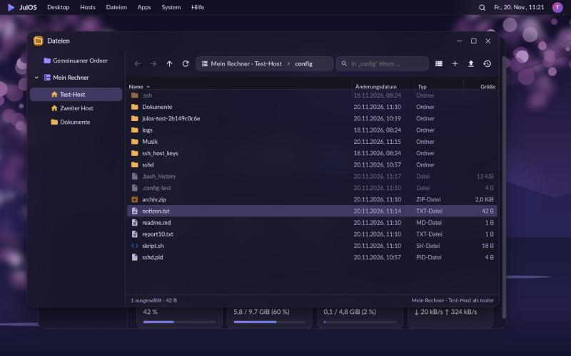

# Files app as a real explorer

Status: **built and released in 0.19.0**, repaired after the owner's first live look (section "Repairs" below, unreleased), requested by the owner on 2026-11-20. It follows the root-file work (`files-root`, see [FILES.md](FILES.md)) and the host login ([HOSTS.md](HOSTS.md#login-one-user-and-password-per-host)) because it changes the same screens.
The goal: the Files app feels like the Windows Explorer the owner knows, on the desktop with a mouse and keyboard, and stays usable on the phone. No server endpoint was added; the confirmation flow, the limits and the security model of [FILES.md](FILES.md) are unchanged.

| Before | After (desktop, light) | After (desktop, dark) | After (phone) |
|---|---|---|---|
|  |  |  |  |

## What was asked for, and what is built

### 1. Behaviour (mouse and keyboard)

- **One click selects, double click opens**: a folder is entered, a text file opens in the editor (below), anything else is downloaded. Link to a folder: entered. On the shared folder (read only) a file is downloaded.
- **Selection like the Explorer:** `Shift` selects a range from the anchor, `Ctrl` adds or removes single items (`Ctrl+Shift` adds a range), `Ctrl+A` all, a **rubber band** dragged on empty space (with `Ctrl` it adds), `Esc` clears. A right click on an item outside the selection selects only that item, inside it keeps the selection.
- **Keys:** `Up`/`Down` (in tiles also `Left`/`Right`), `Home`, `End`, `PageUp`/`PageDown`, with `Shift` they extend the range, with `Ctrl` they only move the focus (`Ctrl+Space` toggles). `Enter` or `Ctrl+Down` opens, `Backspace` or `Alt+Up` goes up, `Alt+Left` back, `Alt+Right` forward, `F2` rename (the name without the extension is preselected), `Del` delete, `F5` refresh, `Ctrl+C`, `Ctrl+X`, `Ctrl+V`, `Ctrl+Shift+N` new folder, `Ctrl+L` edit the path, `Ctrl+F` search, the menu key or `Shift+F10` opens the context menu at the focused item.
- **Type to jump:** typing letters jumps to the first item whose name starts with them; the buffer clears after one second, more letters narrow the match (`do` finds `Documents`), the same letter again and again cycles through all items with that letter. Case does not matter.
- **Context menu** (item, selection, folder, empty area): Open, Download, Cut, Copy, Paste (into the folder or the current folder), Rename, Delete, New folder, New text file, Upload, Refresh, Copy path, Pin to sidebar / Unpin, Properties. Entries that need writing are greyed out (with the reason as tooltip) when writing is off, on the shared folder and in a place without write access.
- **Cut, copy, paste** work within a place and **across places** (the existing server-side stream copy; the clipboard holds only paths and is shared by all windows of the page). **Drag and drop**: files from the list onto a folder row, a path segment of the address bar, a place or a pinned folder in the sidebar; within one place the default is *move* (`Ctrl` copies), between places *copy* (`Shift` moves), as in the Explorer. Files from the computer dropped on a folder row, a path segment or a sidebar entry are uploaded there. Pins can be dragged to reorder them.
- **Every write is one confirmation per action** through the server-issued two-step flow of [FILES.md](FILES.md): a selection of 40 files that is moved, copied or deleted opens one sheet and runs one job, never one per file.

### 2. Look

- One toolbar: **sidebar show/hide**, back, forward, up, refresh, the **address bar** (path as clickable segments; a click on the empty part or `Ctrl+L` turns it into a text field, `Enter` goes, `Esc` cancels), the search field, the **View** menu (list or tiles, compact or comfortable, sort by name, date, type or size, ascending or descending, "Hidden files"), **New** (folder, text file) and **Upload**, and the history. Icons are SVG, never emoji. Below 900 px the buttons show only their icon (details of the address bar and the narrow layouts: section "Address bar" below).
- **Compact list is the default** with the columns *Name, Date modified, Type, Size*; the headers are **flat column headers, not buttons** (text in the label colour, a small arrow for the sort direction, a thin divider at the grip, pointer cursor and colour change only while hovering, focus ring with the keyboard, `Enter` or `Space` sorts); a click on a header sorts (a second click reverses; folders always stay on top; numbers sort naturally, so `file2` comes before `file10`); the column widths can be dragged (or changed with the arrow keys on the focused grip) and are remembered.
- **File extensions are always shown**, there is no setting. The type column shows the extension (`PNG file`, `Folder`).
- **Hidden files** (names starting with a dot) **are shown by default but dimmed** (lighter text and icon); the View menu hides them; remembered per user.
- **Status bar:** number of items (and how many are folders), or the number and size of the selection, and on the right the place and the user it works as (`Host as tester`, root place: `as root`). The root place keeps its red banner and the red mark under the toolbar.
- Names are foreign data: they are always set as text, and control characters, bidi overrides (U+202A-202E, U+2066-2069) and zero-width marks are shown as `<U+202E>` and never take effect (`files-explorer.js`, `safeName`); a name like `.txt` stays text (tried in the browser).

### 3. Sidebar as a tree

- The shared folder stands on its own; **every host is a node** that expands to **Home** and, when the agent allows it, **Root** (red shield), and to **its pinned folders**. Terminal tiles with a program (Codex, Claude Code) and several SSH connections of one host are **not** places of their own; a connection with another login is offered in the host's context menu ("Open as another user"), see [FILES.md](FILES.md).
- **The sidebar is 200 px wide, can be dragged (140 to 360 px, double click on the handle resets, arrow keys on the focused handle) and can be hidden** with the first toolbar button; width and state are remembered per device (`localStorage`, `pd.files.side`).
- **Pin to sidebar** from the context menu of a folder (or the empty area of the current folder), **unpin**, **move up/down** in the pin's menu or by dragging. A pinned folder whose host no longer exists is hidden (the pin stays stored).
- **Stored per user on the server**: the new settings key **`files`** (`GET /api/settings`, `PUT /api/settings/files`, validated by `SettingsRules`, see [FOLDERS.md](FOLDERS.md)) holds `{ view: {mode, density, sortCol, sortDir, showHidden, cols}, pins: [{place, path, name}], closed: [node ids] }`. A pin is only a connection id and a path; it grants nothing (every request is checked as before). The page keeps a local copy as fallback (`localStorage`, key `pd.files.prefs`) and sends changes after 600 ms; at the first start a device with local settings uploads them when the server has none.
- Keyboard: a real `tree` (`role="tree"`, arrow keys, `Right`/`Left` expand and collapse, `Enter` opens, the menu key opens the pin menu).

### 4. Editor

A text file up to **1 MiB** opens in a plain editor **window** (own movable, resizable window, one per file; on the phone a sheet as before): monospace, line numbers, `Ctrl+S`, a **"modified"** marker, a question before closing with unsaved changes. Saving goes through the confirmed write (`prepare upload`, sheet naming host, path and size, then the upload with the token). **A warning** is part of that sheet when the file changed on the host since it was opened (size or time differ, or it is gone): the sheet then needs a tick "Yes, replace it anyway". Without that warning no tick is needed: the sheet says the file is replaced with the edited text. Binary files never open in the editor: a known binary extension or a size over 1 MiB goes to download, and a file the server reports as `not_text` (NUL byte or no valid UTF-8) is downloaded instead of shown. A file longer than 1 MiB, writing off, or the shared folder open read only. On a root place reading first needs the usual root confirmation.
Line endings: `CRLF` files keep `CRLF` on save; a file with mixed endings is made uniform on save (the editor says so). A final newline is kept as typed. The editor has no search, no undo beyond the browser's, and `Tab` moves the focus (no indentation) on purpose: it is for fixing a config file, not for programming.

### 5. Phone

The phone keeps its own layout: a list (two lines per item: name with extension, then size and date), **long press** selects the item, turns the multi-select mode on (a tap then toggles) and opens the **same context menu as a bottom sheet**; a **bottom action bar** appears with the selection (Download, Copy, Cut, Delete, More, Clear). The "place" button opens the **same tree** (hosts, places, pins) in a sheet; pin and unpin work through the menus (on the phone a long press on a pin opens its menu where the browser sends a context menu event). Hidden files dimmed, extensions shown, compact by default; the View menu works the same. Light and dark follow the app.

## Repairs after the first live look (unreleased)

The owner found the 0.19.0 explorer "very buggy and not finished". Found live in the browser pane and fixed:

- **Keyboard focus** was lost after every navigation (double click into a folder, `Backspace`, back/forward, place change, refresh, typed address, closing a menu, dialog or the editor): the list was redrawn and focus fell on the page body, so `Enter`, `F2`, `Del`, arrows, type to jump and `Ctrl+C/X/V` did nothing until the next click. Now the list keeps or regains the focus after each of these steps (`focusPlan`, `settleFocus` in `files-app.js`): when the focus was in the list or nowhere, it goes back to the list (only if this window is the active one, so another window's input is never taken); a mouse click on a toolbar button or a path segment does not take the focus away at all (as in the Explorer; `Tab` and `Enter` still work). An error view takes the focus itself so that back, up and `F5` work there too. After `Up` the folder you came from is selected.
- **The "buttons" were the page's general button style** (round, 44 px high, coloured, `style.css`) leaking into the app: toolbar buttons were 44 px high instead of 32, the header cells and path segments pill shaped, the tree toggles 44 px tall. `files.css` now resets the buttons of the desktop app (`:where(.fdesk) button`, same weight as the general rule, later wins) and each class sets its own flat look: one size (32 px, 6 px corners), the same hover, pressed and focus ring for every toolbar button; **View** and **New** are menu buttons with a small caret; address bar and search field are the same height, border and corners. In a narrow window (main area under 560 px) the buttons share one row and the address bar and the search field each take a full row; nothing is cut off.
- **Window size:** the Files window opens at **70 % of the free area (at least 860 x 540, at most the area)**, at 1920 x 1080 about 1316 x 690; position and size are remembered per device (drag or resize, `localStorage` `rect.files`, as for all windows), the maximise button works as before. `filesWindowSize` in `files-explorer.js`.
- **Sidebar places per host** (see above) and a narrower, draggable, hideable sidebar.
- Smaller finds: on the phone the sticky toolbar block was a dark rectangle on the gradient in the dark scheme (now a translucent, rounded block).

## Address bar and narrow windows (unreleased)

Behaves like the Windows Explorer's address bar (requested 2026-11-21):

- **Breadcrumbs** (root element, then every folder): the bar fills the width, the segments do not, so there is **always free space on the right** to click into. When the window gets narrower the path loses its **beginning**: it becomes a **`<` button** whose menu lists the hidden levels (nearest first, the root element included), the current folder always stays visible (cut with an ellipsis if it alone does not fit). `visibleCrumbCount` in `files-explorer.js`; a `ResizeObserver` re-fits on every width change.
- **Text mode:** a click on the free space, `Ctrl+L` or `F4` turns the bar into a text field with the **full path selected**; an **X** on the right (and `Esc`) discards it. While typing, **suggestions** list the sub folders of the typed parent path whose name starts with what is typed (case does not matter; dot folders only after a typed dot; at most 8). They come from the folder already shown or from an ordinary list request of the parent folder (cached while the field is open; no new endpoint, the usual rights and confirmations apply; no suggestions for `~` paths, the server resolves those). `Up`/`Down` choose (`Down` past the last or `Up` before the first goes back to no choice), `Tab` completes the chosen (or first) one and adds `/`, `Enter` goes to the chosen suggestion or the typed path; a path that does not exist shows the short message "Den Pfad gibt es nicht." (the view stays). `splitTyped`, `filterSuggestions`.
- **One toolbar row, nothing wraps (desktop):** at the main area's width of **900 px and more** the buttons carry labels; **below 900** icons only; **below 760** the search field is an icon that unfolds when clicked (or `Ctrl+F`) and stays open while it holds text; **below 520** *Refresh*, *View*, *New*, *Upload* and *History* fold into one **"..." menu**. On the phone the layout is unchanged (place button, buttons, address bar on its own row; the address bar there uses the same breadcrumbs and text mode).

## Dialogs are windows (unreleased)

Wish of 2026-11-21: nothing in the Files app blocks the whole desktop any more. On the **desktop** every dialog of the app (confirmations, name input, progress, host key, password, properties, history, the "writing is off" explanation, the editor and its "discard changes?" question) opens as a **window** in the window manager of `desktop.js`; on the **phone** everything stays a full-screen or bottom sheet as before. One test decides: `!kit` (the app's own phone flag) and a registered window host (`html.desktop`). Plan and reasons: [FILES-VIEWER.md](FILES-VIEWER.md), part A and step 1.

**Pieces.** `desktop-window.js` exports `openDialogWindow({title, content, actions, key, owner, width, height, resizable, root, focus})` with the same contract as `modal()` in `files-ui.js` (`{el, close(result), promise, setDisabled, setLabel, setHidden, setTitle}`; the promise gives the id of the pressed button or `null`). `modal()` delegates to it on the desktop, so every call site moved without change. `desktop.js` registers one small factory (`dialogFrame`, built on `createWindow`): a window without dock entry, minimise and maximise, centred over its owner and offset a little for each further dialog. The styles are in `dialogwin.css` (loaded by `desktop.js` only; the phone never loads it).

**Rules (protection, not looks):**

- **Closing never confirms.** The close button, `Escape`, closing the window that opened the dialog, and signing out all end a dialog with `null`. A confirmation is only given by its own button (`yes`). A dialog may refuse to close (the browser's `cancel` event, `preventDefault`): the progress window until it has finished, the editor with unsaved changes (it asks first). Closing an owner window asks its dialogs first; one that refuses keeps the owner open and comes to the front. `tests/frontend/dialogwin.test.mjs` pins this.
- **Confirmations keep their content and the two-step token logic.** Host, path, count, "as root", level, warning, tick or typed host name come from `prepare` as before. New: the window title names action and host (`Delete · <Host>`, so a window found later is unmistakable; a root place has a red title bar), the **focus starts on "Cancel"** (`Enter` never confirms, "Run" needs a click), a line counts down the 60 seconds, and after that "Run" stays off (ticking the box no longer switches it on).
- **Non-modal, nothing trapped:** several windows at once; a dialog is raised **with** its owner and always **above** it (the editor's question above the editor, the editor above the Files window); focus moves into the window when it opens and **back to the opener** when it closes (if the focus was still in the window or nowhere); `Tab` is not trapped; `Escape` closes only the dialog window that has the focus, never an app window.
- **One per key:** the editor is one window per file (opening the same file again brings it to the front; two files give two windows), history and properties open once.
- **Progress is a window** with "Cancel" that does not block: the list refreshes at the end of a copy, move, delete or upload while the window still shows the result.

**Not done here (step 2 of the plan):** the 19 static `<dialog>` elements of `index.html` (host action confirmation `hostActDlg`, second factor `stepUpDlg`, connection, security, ...) still use `showModal()`; so does a second-factor request that comes up during a Files action. They move with `showDialog()` in step 2.

**Verified in the browser pane** against a local test instance (own compose project, `wwwroot` mounted; shared folder and one SSH host): desktop 1500x900 and 1000x700 (light and dark), phone 375x812. Seen: host key window, name window, confirmation (create, save, delete, copy), progress window, history, the rename window; several windows at once, drag, raise with the owner, `Escape` and the close button cancel (the file stayed), `Enter` on the focused "Cancel" cancels, the editor saves through the confirmation (`Ctrl+S`), closing the editor or the Files window with unsaved changes asks first, focus returns to the list; the phone still shows the bottom sheet.

## Viewer (unreleased)

A double click (or **View** in the context menu) on a file with the extension of an image (`png jpg jpeg gif webp avif`), video (`mp4 webm`), audio (`mp3 ogg wav flac m4a`) or PDF opens the **preview** (`files-viewer.js`, `viewer.css`, plan in [FILES-VIEWER.md](FILES-VIEWER.md)); every other file opens as before (editor or download). On the desktop it is a resizable dialog window, on the phone a full-screen sheet with the same content: name, size, place and folder (images also the pixel size), a tool bar, the picture, and **Download** and **Close** at the bottom. A file the preview refuses (not on the list, too large, video or audio on a root place, content that does not match the extension) says why in the window (`files.err.preview_*`) and keeps the Download button.

- **Images:** fit to the window (never above 100 %), zoom with the buttons, `+` `-`, `0` (fit), `1` (100 %), `Ctrl`+wheel or double click, drag to move when larger than the window. `Left` and `Right` go to the previous or next image of the folder as listed (no wrap; the counter "3 of 5" shows where you are). Neighbours are not offered on a root place.
- **Video and audio:** the browser's own player with seeking (`Range`); what the browser cannot play shows a message and Download. Closing the window or switching file stops the stream.
- **PDF:** pdf.js draws every page on a canvas of our own page when it comes into view and drops far-away pages; fit to width, zoom, previous and next page, "Page 3 of 12". Password-protected or damaged files show a message.
- **Data path:** only `GET /api/files/preview` or `/api/files/remote/preview` (session needed). On a **root place** only image and PDF, after the usual confirmation (`prepare` with `action: preview`, a window "as root", token valid once), fetched once and shown from a `blob:`. Nothing from a file is ever put into `innerHTML`; object URLs and streams are released on switching and closing. The window stays tied to the place the file came from, even if the Files window moves on.
- **One viewer per Files window:** opening another file shows it in the open viewer.

**Verified in the browser pane** against a local test instance (own compose project, `wwwroot` mounted; the shared folder and an SFTP host): png, jpg, mp4 (with seeking), webm, mp3, a 12-page PDF with mixed page sizes, a password-protected PDF, a file with a wrong extension (`preview_content`) and one over the limit (`preview_too_large`), on both places; next and previous image, zoom keys, page buttons, the context-menu entry, closing frees the media; desktop 1500x900 (light and dark), 1000x700 (dark), phone 375x812 (dark and light). Not checked: a root place against a real host with an agent, Firefox and Safari, a PDF with non-embedded CJK fonts or with JPEG 2000 images, a touch screen (pinch and drag), a very large PDF.

## Decisions and differences from the specification

- **Editor and dialogs are windows on the desktop** (see "Dialogs are windows" above). On the phone the editor stays a full-screen sheet.
- **"Open in new window" is not built.** The desktop has one Files window; there is no second one to open into. Drag and drop between windows works through shared state of the page, so it would work as soon as a second window exists.
- **Properties** shows name, folder, type, size, time and mode of one item; no owner or permission changes.
- **The shared folder is a place of its own** (not one of each host's places): it is the server's folder and read only. It has its own node in the tree and can have pins.
- **Search:** in the shared folder it is the server search as before (also in sub folders); on hosts it **filters the current folder** by name (no search on hosts, as before, see [IDEAS.md](IDEAS.md)).
- **"Copy to / Move to" dialog removed:** cut, copy, paste and drag and drop do the same (also across hosts), so the extra folder chooser is gone.
- **Pasting or dropping needs both places open** (a password-less connection asks for the password first, as before). Copy and move are not offered from the shared folder (it is read only); a drop of files from the list onto the shared folder is refused.
- **No automatic scrolling while dragging a rubber band**, no thumbnails in the list, no zip of a selection (download is for one file). Listed in [IDEAS.md](IDEAS.md) where useful.
- **Hidden files in the shared folder:** the server already leaves them out there; the switch affects hosts.

## Tests

- `tests/frontend/files-explorer.test.mjs`: the pure logic only (breadcrumb fitting and address suggestions, sidebar state and window size, selection with `Shift`/`Ctrl`/arrows/rubber band, type to jump, sort, names and bidi characters, editable or not, key to action, view and pin normalisation and order, paste and drop rules, typed paths). No tests of looks or DOM behaviour. `tests/frontend/i18n.test.mjs` (same keys in German and English), `sw-shell.test.mjs` (every file of the shell exists) cover the rest of the page.
- `tests/frontend/files-viewer.test.mjs`: the pure logic of the viewer (type by extension, the same list as `Files/FilePreview.cs`, limits like the server, neighbouring images, zoom and fit, page at the top, preview addresses); `tests/frontend/vendor.test.mjs`: every file under `wwwroot/vendor` against the SHA-256 in `vendor/README.md`. Nothing about looks.
- `tests/JulOS.Backend.Tests/SettingsTests.cs` has one test for the new key `files` (unknown fields dropped, sizes bounded, bad values refused).
- Checked by hand in the browser pane against the dev instance (desktop 1280x800 and phone 375x812, light and dark): the list, selection with the mouse (range, rubber band) and keys, type to jump, context menu, rename with `F2`, new folder and new text file, move by drag and drop, copy between two places of one host, pinning (stored on the server and back after a reload), view menu (tiles, hidden files, sorting), the editor with save, with the "changed on the host" warning and with the discard question, the multi-select bar and the sheet on the phone.
- **Verified after the repairs** in the browser pane against a local server (desktop 1500x900, 1100x640 dark, 1920x1080 and phone 375x812): focus after double click, `Backspace`, back, forward, up, refresh, typed address, menu, `F2` dialog, editor, error view; toolbar and header sizes read from the computed styles; sidebar hide, drag and the host menu; window size at 1500 and 1920 wide.
- **Not verified:** a real second host and a real root place, a real phone (long press with a finger), Windows Brave, a Mac keyboard (`Cmd` is treated like `Ctrl`), a screen reader, very large folders (2000 entries are drawn at once), the rubber band with a scrolled list.
